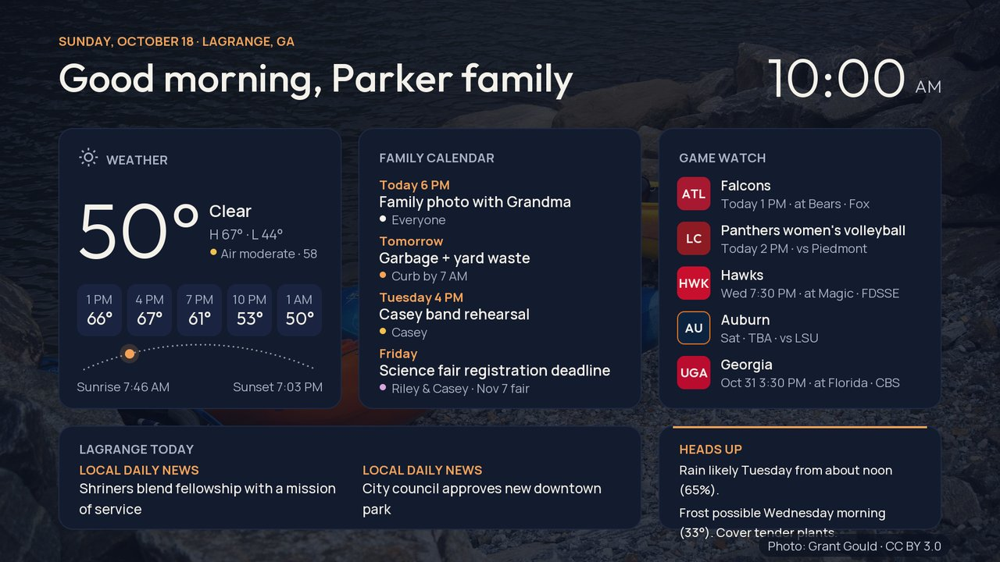
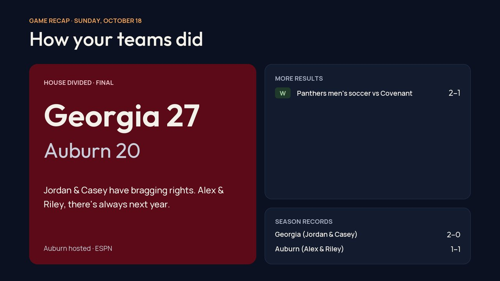
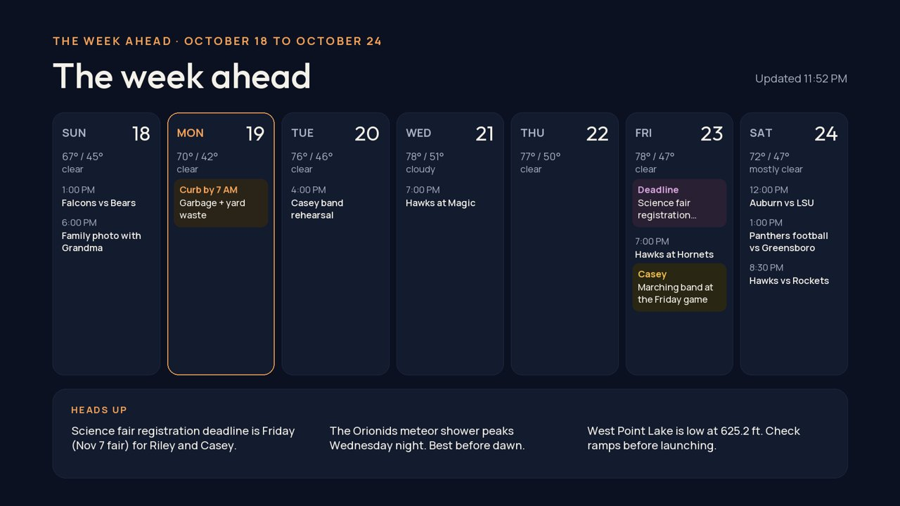
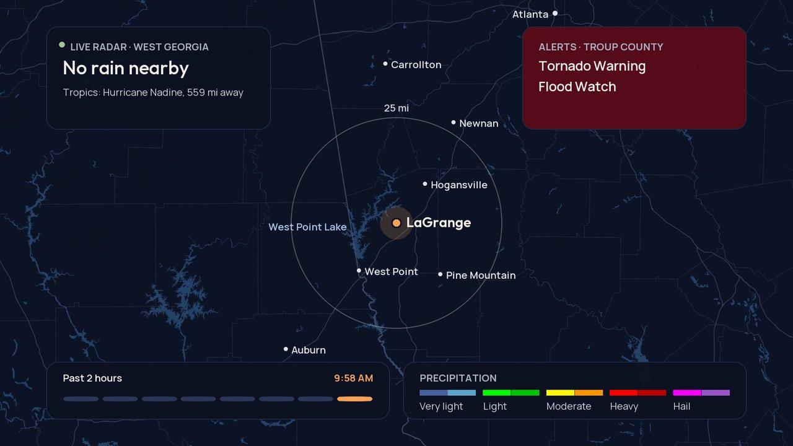
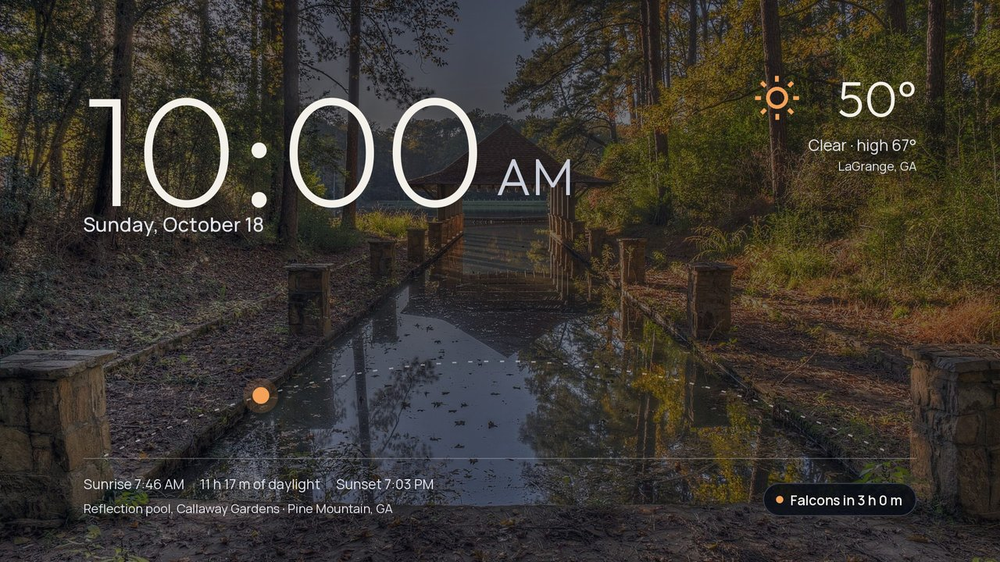
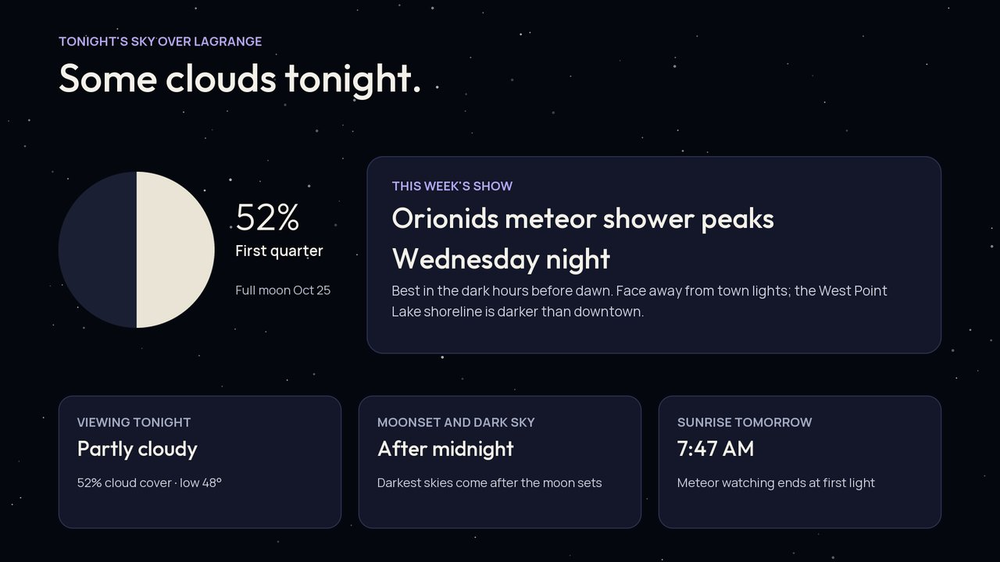
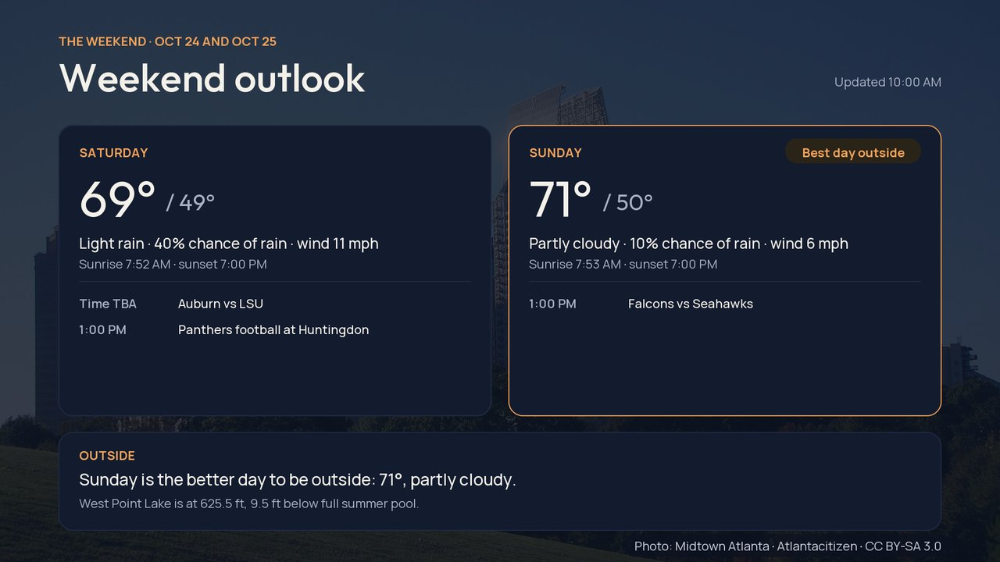
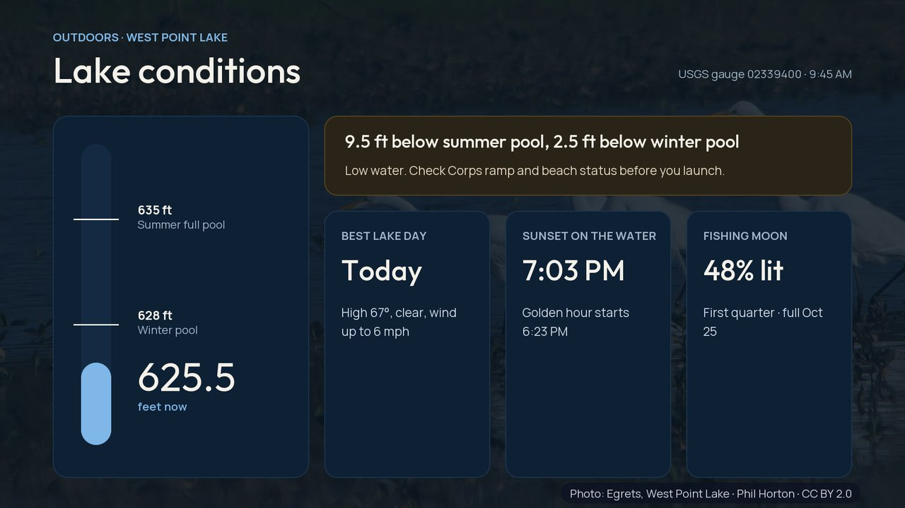

# tv-check → Daybreak

[](https://github.com/roberjo/tv-check/actions/workflows/ci.yml) [](https://github.com/roberjo/tv-check/actions/workflows/codeql.yml) · [Releases](https://github.com/roberjo/tv-check/releases) · [Roadmap](https://github.com/users/roberjo/projects/2) · [Changelog](CHANGELOG.md) · [Security](SECURITY.md) · [Contributing](CONTRIBUTING.md)

**What started as "what can an AI learn about my TV over Wi-Fi?" ended up as Daybreak, a standalone family dashboard and screensaver running natively on a TCL Roku TV.**

Built in one evening, pair-programming with [Claude Code](https://claude.com/claude-code). The write-up is in [`docs/blog-post.md`](docs/blog-post.md).

| | |
|---|---|
|  |  |
|  |  |
|  |  |
|  |  |

*Screenshots are rendered from the TV's own screen code (`daybreak/preview/`) with a fictional family (`config/family.example.json`), a synthetic calendar and synthetic feeds.*

## What's here

| Path | What |
|---|---|
| `scripts/` | The exploration toolkit (Python stdlib): SSDP discovery, Roku ECP probe, port scan, AirPlay info, debug-console helper, health sampler, radar map renderer, City of LaGrange curbside rules, iCal reader, safe deploy |
| `FINDINGS.md`, `DIAGNOSTICS.md` | What a Roku TV exposes on the LAN, and a full health check (RAM, storage, network, codecs, DRM) with recommendations. Identifiers redacted |
| `diag-channel/` | A tiny sideloaded diagnostic app that reports display, codec, network, memory and DRM capabilities and runs a speed test |
| `daybreak/channel/` | **Daybreak**, the standalone Roku app (BrightScript and SceneGraph). The TV fetches everything itself |
| `daybreak/tests/` | Off-device tests run with [`@rokucommunity/brs`](https://github.com/rokucommunity/brs) against synthetic feeds and a synthetic calendar, with the clock pinned |
| `daybreak/preview/` | Renders every screen from the TV's own code, off-device, and audits text size and contrast |
| `daybreak/art/` | Photos, fonts and drawing code the build turns into the package's images |
| `attic/` | Shelved experiments, unmaintained: the Siri → Claude → Roku voice concierge |
| `DAYBREAK.md` | Daybreak design notes: screens, triggers, rules, visual system, licensing, privacy |
| `CLAUDE.md` | The working rules the AI followed: what's read-only, what needs permission first |
| `docs/DEVELOPMENT.md` | Build, test, CI, install and release process |
| `docs/CONFIGURATION.md` | `family.json` and the `place` block for other towns |
| `docs/ARCHITECTURE.md` | Data flow, freshness rules, memory budget, overlays |

## Daybreak at a glance
- **Data, all fetched on the TV:**
  - **Weather:** Open-Meteo.
  - **Alerts:** National Weather Service.
  - **West Point Lake level:** USGS.
  - **Radar:** NOAA MRMS.
  - **Pro and SEC schedules:** ESPN's public JSON.
  - **LaGrange College athletics:** iCal feed.
  - **Local headlines:** Google News RSS.
  - **The family calendar:** Google Calendar secret iCal.
  - **Air quality:** Open-Meteo (US AQI).
  - **The tropics:** National Hurricane Center, June to November.
  - **Weather at outdoor games:** Open-Meteo, at the stadium, for the game's start time.
- **Rule-based "heads up" insights:** deadlines, schedule overlaps, curbside pickup (including holiday shifts), rain and frost, rain at game time, air quality, countdowns, birthdays, meteor showers, Atlantic storms and low lake levels. No AI at runtime.
- **Live scores** during your teams' games, refreshed every 2 minutes.
- **Family board through the calendar:** an event called `TV: Dinner at 6:30` shows as a note, `Buy: milk, eggs` adds to a grocery list, and `Countdown: Beach trip` counts down the days.
- **On the remote:** OK opens a menu (settings, go to a screen, diagnostics), and * shows diagnostics: feed health, memory, network and a speed test.
- **Privacy defaults:** health appointments show as "Appointment", and violent-crime headlines are filtered out.
- **Local wallpapers:** 36 free-licensed photos from around LaGrange, West Point Lake, Pine Mountain, Columbus, Newnan, Peachtree City and Atlanta, a different one behind each screen every day. The TV downloads them from this repo, each with an on-screen credit.
- **Design:** tested for readability, with contrast measured against the photo behind every line of text, for every wallpaper on every screen it can appear on.

## Run it yourself
You need a Roku TV with **developer mode** on (Home ×3, Up ×2, Right, Left, Right, Left, Right) and "Control by mobile apps" set to **Enabled**. Both open interfaces to anyone on your LAN, so only do this on a network you trust.

Each [release](https://github.com/roberjo/tv-check/releases) has a demo package (the fictional family, no calendar) you can sideload to try it. For your own household, build it:

```sh
python3 -m venv .venv && .venv/bin/pip install -r requirements-dev.txt
npm ci --ignore-scripts                               # emulator + BrighterScript (Node 20+)
cp .env.example .env                                  # TV IP, dev password, calendar iCal URL
cp config/family.example.json config/family.json      # your household
.venv/bin/python daybreak/build_channel.py            # generates assets + config, validates, zips
python3 scripts/deploy.py                             # installs only if nobody is watching; asks first
# Then pick Settings → Theme → Screensaver → Daybreak.
```

Tests (Node required, no network):
```sh
daybreak/tests/run.sh                 # library: curbside, dates, sky, iCal (RRULE + EXDATE)
daybreak/tests/run_data.sh            # derive() + every screen against synthetic feeds
daybreak/tests/fetch_fixtures.sh && daybreak/tests/run_live.sh   # optional: today's real feeds
```
More in [`docs/DEVELOPMENT.md`](docs/DEVELOPMENT.md).

Daybreak defaults to LaGrange, Georgia. Your town, teams, rivalry, lake, college feed and news queries go in a `place` block in `config/family.json`; see [`docs/CONFIGURATION.md`](docs/CONFIGURATION.md).

## Licensing
- **Code:** MIT (see `LICENSE`).
- **Fonts:** Outfit and Manrope, SIL Open Font License 1.1 (`daybreak/art/fonts/OFL-*.txt`).
- **Photos:** Wikimedia Commons, under each photo's own license: CC0, public domain, CC BY or CC BY-SA. The list is in [`daybreak/wallpapers/CREDITS.md`](daybreak/wallpapers/CREDITS.md). The cropped copies keep their licenses, so the BY-SA ones stay BY-SA.
- **Team logos:** trademarks of their teams. They aren't in this repo; the TV loads them from ESPN's CDN for display on a home TV, the same way it reads ESPN's schedules.
- **Map and radar data:** USGS and NOAA, public domain.

Not affiliated with Roku, TCL or any of the data providers.
